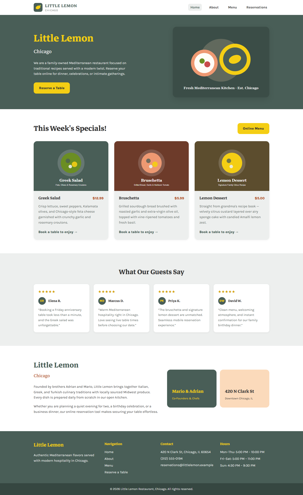
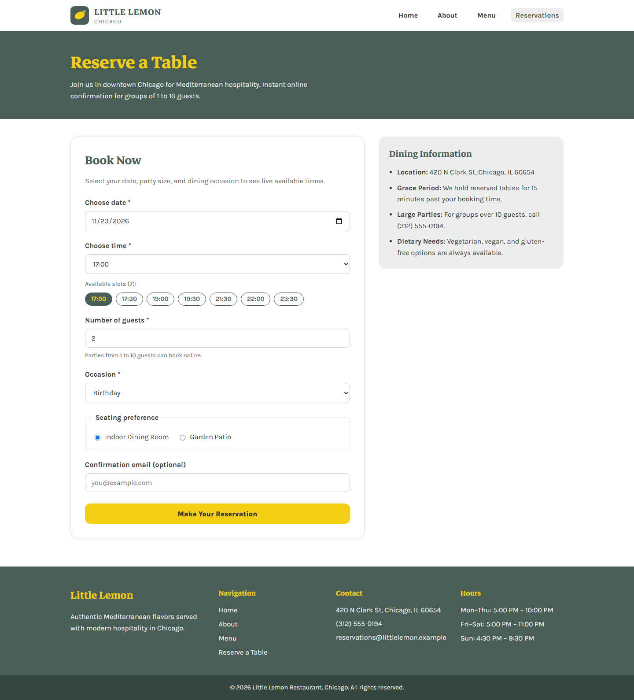
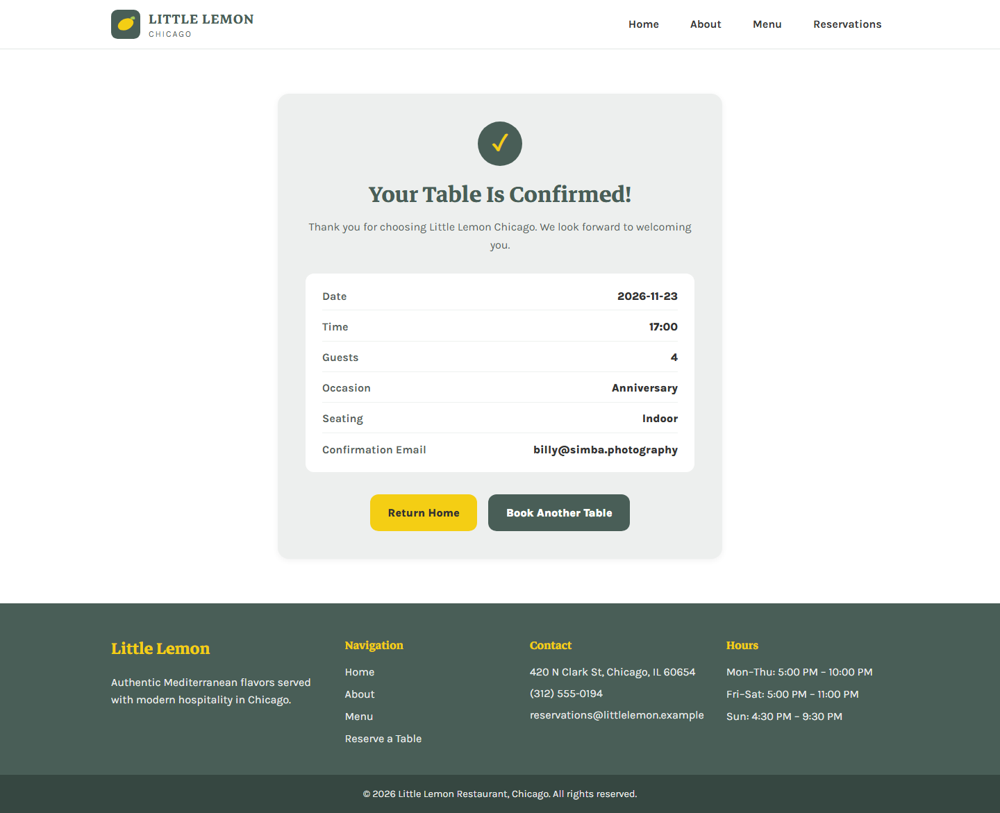
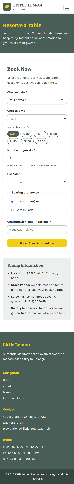

# Little Lemon Chicago — Table Booking Web Application

**Meta Front-End Developer Capstone Project** by **Billy Simba**

- **Live Deployed App:** [https://little-lemon-chicago-billysimba.surge.sh](https://little-lemon-chicago-billysimba.surge.sh)
- **Live Table Booking Route:** [https://little-lemon-chicago-billysimba.surge.sh/booking](https://little-lemon-chicago-billysimba.surge.sh/booking)
- **GitHub Repository:** [https://github.com/BillySimba/little-lemon-chicago](https://github.com/BillySimba/little-lemon-chicago)

A responsive, WCAG-accessible React web application built for **Little Lemon** in Chicago, featuring the full Figma-aligned brand UI (`#495E57` olive green, `#F4CE14` lemon yellow, `Markazi Text` + `Karla`), interactive table reservation backed by `fetchAPI` / `submitAPI` (`src/utils/bookingAPI.js`), lifted `useReducer` slot state (`src/components/Main.js`), HTML5 + client-side validation (`src/utils/validation.js`), booking confirmation (`/confirmed`), and **15/15 passing Jest & React Testing Library unit tests**.

---

## Live Rendered UI Screenshots (Figma Mockup & Responsive Wireframe)

### 1. Desktop Homepage (`1440×900`) — Hero, Weekly Specials, Testimonials, About & Footer


### 2. Desktop Table Reservation Page (`1440×900`) — Controlled `BookingForm` & Live Time Slots


### 3. Desktop Confirmed Booking View (`1440×900`) & Mobile Responsive Booking Layout (`390×844`)
| Booking Confirmation (`/confirmed`) | Mobile Responsive Layout (`390×844`) |
| --- | --- |
|  |  |

---

## Peer-Review Rubric Verification Guide (9 / 9 Criteria)

For quick verification without needing to clone locally first, every rubric item maps directly to the live demo and source files below:

| # | Peer-Review Rubric Question | Where to Verify (Direct Links) | Implementation Details |
| --- | --- | --- | --- |
| 1 | **Matches the UI/UX from the Figma mockup and wireframe** | [Live Demo](https://little-lemon-chicago-billysimba.surge.sh) · [`src/App.css`](https://github.com/BillySimba/little-lemon-chicago/blob/main/src/App.css) · Screenshots above | Faithful `#495E57` / `#F4CE14` / `#EDEFEE` palette, `Markazi Text` & `Karla` typography, Hero CTA banner, 3-card Weekly Specials (`Greek Salad`, `Bruschetta`, `Lemon Dessert`), Testimonials, Chicago story, and Booking flow. |
| 2 | **Uses semantic HTML tags appropriately** | [`src/App.js`](https://github.com/BillySimba/little-lemon-chicago/blob/main/src/App.js) · [`Header.js`](https://github.com/BillySimba/little-lemon-chicago/blob/main/src/components/Header.js) · [`Nav.js`](https://github.com/BillySimba/little-lemon-chicago/blob/main/src/components/Nav.js) · [`Main.js`](https://github.com/BillySimba/little-lemon-chicago/blob/main/src/components/Main.js) · [`Footer.js`](https://github.com/BillySimba/little-lemon-chicago/blob/main/src/components/Footer.js) · [`BookingPage.js`](https://github.com/BillySimba/little-lemon-chicago/blob/main/src/pages/BookingPage.js) | Semantic `<header>`, `<nav>`, `<main id="main-content">`, `<section>`, `<article>`, `<aside>`, `<figure>`, `<fieldset>`, `<legend>`, `<address>`, `<dl>`, and `<footer>` landmarks. |
| 3 | **Layouts correctly for both mobile and desktop devices** | [`src/App.css#L733-L789`](https://github.com/BillySimba/little-lemon-chicago/blob/main/src/App.css#L733-L789) · Desktop & Mobile screenshots above | CSS Grid & Flexbox with breakpoints at `<= 960px` and `<= 640px`, collapsible hamburger menu on mobile (`0px` horizontal overflow verified at `1440×900` and `390×844`). |
| 4 | **Appropriate `<meta>` tags and Open Graph Protocol (OGP) tags used** | [`public/index.html#L9-L21`](https://github.com/BillySimba/little-lemon-chicago/blob/main/public/index.html#L9-L21) · Snippet below | `<meta name="description">`, `og:title`, `og:description`, `og:type`, `og:image`, and `og:site_name` present in `<head>` (also inspectable live on the Deployed App via DevTools Elements). |
| 5 | **Is the `BookingForm` component a child component?** | [`src/pages/BookingPage.js#L21-L26`](https://github.com/BillySimba/little-lemon-chicago/blob/main/src/pages/BookingPage.js#L21-L26) · [`src/components/BookingForm.js`](https://github.com/BillySimba/little-lemon-chicago/blob/main/src/components/BookingForm.js) | `BookingForm` is a reusable child component rendered inside `BookingPage` (which itself is rendered by `Main`), receiving `availableTimes`, `dispatch`, and `submitForm` props. |
| 6 | **Is the state of the available times managed from the parent component of `BookingForm`?** | [`src/components/Main.js#L15-L78`](https://github.com/BillySimba/little-lemon-chicago/blob/main/src/components/Main.js#L15-L78) | Parent `Main` holds `const [availableTimes, dispatch] = useReducer(updateTimes, [], initializeTimes);` backed by `fetchAvailableTimes`, dispatches date updates and `BOOK_SLOT` removals, and passes `availableTimes` & `dispatch` to `BookingPage` -> `BookingForm`. |
| 7 | **Does the booking form implement client-side validation?** | [`src/components/BookingForm.js#L37-L299`](https://github.com/BillySimba/little-lemon-chicago/blob/main/src/components/BookingForm.js#L37-L299) · [`src/utils/validation.js`](https://github.com/BillySimba/little-lemon-chicago/blob/main/src/utils/validation.js) | Dual HTML5 constraints (`required`, `type="date"`, `min={todayISO}`, `type="number"`, `min={1}`, `max={10}`, `type="email"`) + pure React validation helpers (`isValidDate`, `isValidTime`, `isValidGuests`, `isValidOccasion`, `validateBookingForm`) with inline `role="alert"` messages and disabled submit state when invalid. |
| 8 | **Are there unit tests added for form component and validation?** | [`src/BookingForm.test.js`](https://github.com/BillySimba/little-lemon-chicago/blob/main/src/BookingForm.test.js) · [`src/App.test.js`](https://github.com/BillySimba/little-lemon-chicago/blob/main/src/App.test.js) | Jest + React Testing Library tests for static rendering, HTML5 attributes, `dispatch` behavior, valid & invalid JS validation helpers (`isValidDate`, `isValidGuests`, `isValidTime`, `isValidOccasion`, `validateBookingForm`), form submission, empty-slot edge case, and `initializeTimes` / `updateTimes` reducer logic. |
| 9 | **Do the unit tests pass successfully?** | Run `npm test -- --watchAll=false` · Verified output below | **`Test Suites: 2 passed, 2 total` \| `Tests: 15 passed, 15 total`** (`0` failures). |

### Meta & Open Graph Protocol Tags Excerpt ([`public/index.html`](https://github.com/BillySimba/little-lemon-chicago/blob/main/public/index.html#L9-L21))
```html
<meta
  name="description"
  content="Little Lemon is a family-owned Mediterranean restaurant in Chicago focused on traditional recipes served with a modern twist. Reserve a table online in seconds."
/>
<!-- Open Graph Protocol (OGP) Meta Tags -->
<meta property="og:title" content="Little Lemon Chicago — Reserve a Table Online" />
<meta
  property="og:description"
  content="Experience authentic Mediterranean cuisine in Chicago. Browse our weekly specials and reserve your table online at Little Lemon."
/>
<meta property="og:type" content="website" />
<meta property="og:image" content="%PUBLIC_URL%/og-little-lemon.svg" />
<meta property="og:site_name" content="Little Lemon Restaurant" />
```

### Verified Unit Test Output (`npm test -- --watchAll=false`)
```text
PASS src/BookingForm.test.js
PASS src/App.test.js

Test Suites: 2 passed, 2 total
Tests:       15 passed, 15 total
Snapshots:   0 total
Time:        3.975 s, estimated 4 s
Ran all test suites.
```

---

## Project Structure

```text
little-lemon-capstone/
├── docs/                       # Live rendered Desktop & Mobile UI screenshots
│   ├── desktop-home.png
│   ├── desktop-booking.png
│   ├── desktop-confirmed.png
│   └── mobile-booking.png
├── public/
│   ├── index.html              # Semantic HTML shell, OGP meta tags, fonts, API script
│   └── og-little-lemon.svg     # Open Graph social preview card & favicon
├── src/
│   ├── components/
│   │   ├── BookingForm.js      # Controlled reservation form with validation & slots
│   │   ├── BookingSlot.js      # Interactive available-time chip component
│   │   ├── CallToAction.js     # Homepage hero CTA banner
│   │   ├── Chicago.js          # Restaurant backstory section
│   │   ├── ConfirmedBooking.js # Post-submission confirmation summary view
│   │   ├── CustomersSay.js     # Guest testimonials grid
│   │   ├── Footer.js           # Site footer with navigation, contact & hours
│   │   ├── Header.js           # Brand header wrapping Nav
│   │   ├── Main.js             # Router + lifted useReducer booking state + submitForm
│   │   ├── Nav.js              # Responsive navigation bar
│   │   └── Specials.js         # Weekly specials cards grid
│   ├── data/
│   │   └── menuData.js         # Specials & testimonials data with XML-escaped SVG visuals
│   ├── pages/
│   │   ├── AboutPage.js
│   │   ├── BookingPage.js      # Wraps child <BookingForm /> with dining sidebar
│   │   ├── HomePage.js
│   │   └── MenuPage.js
│   ├── utils/
│   │   ├── bookingAPI.js       # fetchAvailableTimes / submitBookingData API wrapper
│   │   └── validation.js       # Pure date, time, guests, occasion, email validators
│   ├── App.css                 # Responsive Grid/Flexbox brand styles
│   ├── App.js                  # Root fragment + BrowserRouter
│   ├── App.test.js             # App & reducer unit tests
│   ├── BookingForm.test.js     # Form rendering, HTML5/JS validation & edge-case tests
│   ├── index.css               # Design tokens & base reset
│   ├── index.js                # React 18 entry point
│   └── setupTests.js           # Jest DOM matchers
└── package.json
```

---

## Getting Started

### Prerequisites
- **Node.js** (v18 or higher recommended)
- **npm** (v9 or higher)

### Installation
```bash
git clone https://github.com/BillySimba/little-lemon-chicago.git
cd little-lemon-chicago
npm install
```

### Run Development Server
```bash
npm start
```
Open [http://localhost:3000](http://localhost:3000) in your browser and click **Reserve a Table** or **Reservations** in the navigation bar.

### Run Unit Tests
```bash
npm test -- --watchAll=false
```

### Build for Production
```bash
npm run build
```
